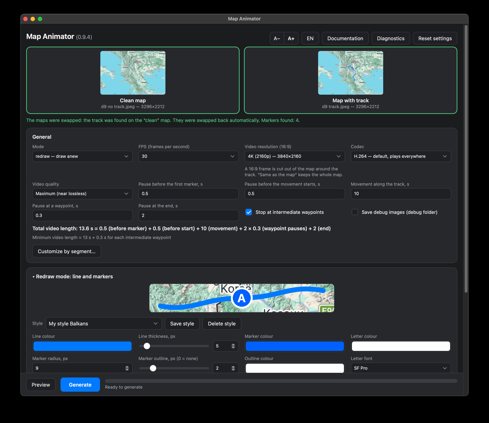
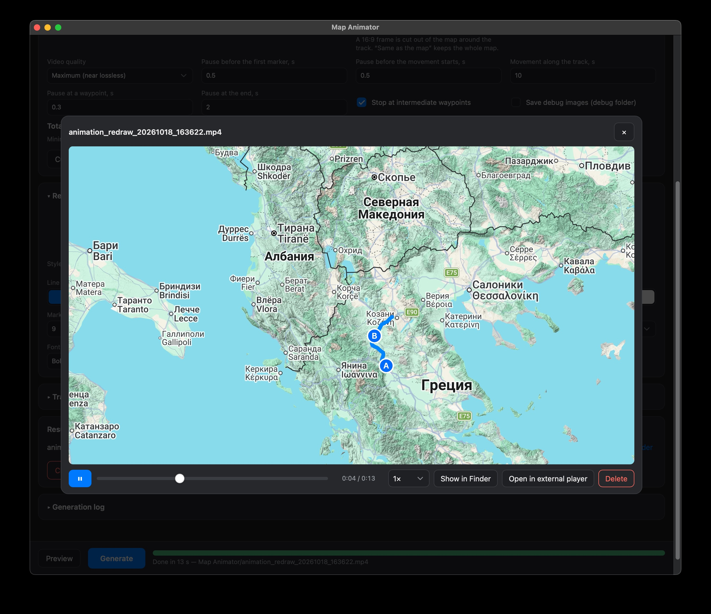
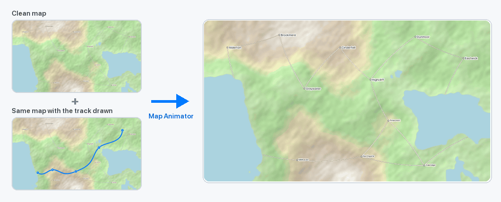

# Map Animator

**English** · [Русский](README.ru.md)

| Main App | Player |
| :---: | :---: |
|  |  |

Turn two pictures of a map into a video: a blue track "travels" across the map from point A to the last stop, and round markers with the letters A, B, C… appear on the way.



* **Input:** a **clean map** and the **same map with a blue track and round stop markers** drawn on it (a screenshot with the route, for example).
* **Output:** an **MP4 video** (16:9 by default, near-lossless H.264/H.265, up to 4K).
* **Two ways to use it:** a macOS app with a window (drag & drop, settings, preview, built-in player), or a command-line tool for scripts.

> The demo maps in `examples/` are generated synthetically (`tools/make_demo.py`), so they are free of any third-party map data. Use your own maps at your own responsibility with respect to the map provider's terms.

---

## 1. Install

**Requirements:** a Mac with **Apple Silicon or an Intel processor**, macOS 13 or newer, internet access for the first start. There is one universal app for both; macOS runs the right half by itself, and the installer downloads the packages that fit your processor. Python 3 (any, for your Mac's own processor type) comes with Apple's Command Line Tools (macOS offers to install them if they are missing — anyone who has ever used `git` already has them).

### A. From the disk image (recommended)

1. Get `Map-Animator-<version>.dmg` (a GitHub release, or build it yourself: `./make_dmg.sh`).
2. Open it and **drag *Map Animator* onto *Applications***.
3. The first time, **right-click the app → Open → Open** (the app is not signed by Apple). If macOS still refuses: `xattr -dr com.apple.quarantine "/Applications/Map Animator.app"`.
4. On the first start the app sees that the Python packages are not installed yet, asks *"Install now?"*, and opens Terminal with a guided installer (checks Python, creates an environment, installs OpenCV, SciPy, scikit-image, ffmpeg… — 1–3 minutes). When it is done the app continues by itself.

### B. From the source (for the command-line tool and for developers)

```bash
git clone <this repository>
cd <folder>
./install.command            # guided: Python check, .venv, packages, self-test
./build_app.sh               # builds Map Animator.app (or ./make_dmg.sh for a disk image)
```

**Which Python is used.** The installer never installs a Python of its own: it looks for the ones already on your Mac (Homebrew, python.org, pyenv, the system one), keeps those that are 3.9+ and really work, and takes the newest one up to 3.13 (it prints what it found and what it chose). To force one: `./install.command --python=/path/to/python3` or `MAP_ANIMATOR_PYTHON=…`. It only talks to the environment it creates (`…/bin/python -m pip`), so `python` / `python3` / `pip3` naming on your machine does not matter.

`install.command` flags: `--check` (only check), `--yes` (no questions), `--no-open`, `--python=PATH`. The command-line tool and `python ui.py` use the `.venv` of the checkout. **The app finds its Python by itself**: first its own environment (`~/Library/Application Support/Map Animator/venv`), then the `.venv` next to the sources it was built from (local builds only — disk images contain no personal paths), then any Python on the Mac that already has every package (Homebrew, python.org, Xcode tools). It offers the guided installation only if none of them is complete. What it checked and chose is written to `~/Documents/Map Animator/logs/app.log`.

### Where your files are

| What | Where |
|---|---|
| **Finished videos** | `~/Documents/Map Animator/` |
| Debug images (`--debug`) and logs | `~/Documents/Map Animator/debug/`, `~/Documents/Map Animator/logs/` |
| The Python environment, settings, styles, uploaded maps | `~/Library/Application Support/Map Animator/` (hidden; the environment is ≈ 700 MB, which is why it is not in Documents — Documents may be synced to iCloud) |
| The program itself (code, page, config, docs) | inside `Map Animator.app`; replace the app to update, your data is untouched |

*Uninstall:* delete the app, `~/Library/Application Support/Map Animator/` and, if you wish, `~/Documents/Map Animator/`. In a source checkout (running `ui.py` / `animate_map.py` directly) everything stays inside the project folder (`output/`, `debug/`, `logs/`).

## 2. Quick start (the app)

1. Open **`Map Animator.app`** (double-click).
2. Drag **both maps** onto the window — the clean one and the one with the track. You can drop both files at once (the file with `track` in its name is taken as the map with the track), or one at a time, or click a field to choose a file. *No maps at hand? Use `examples/demo_clean_map.jpg` and `examples/demo_track_map.jpg`.*
3. In a second the app checks the maps and tells you how many markers it found and how long the video will be.
4. Adjust the settings if you like (everything is remembered).
5. Press **Generate**. A progress bar with the remaining time runs at the bottom.
6. The finished video appears in the **Results** list: **▶ Watch** (built-in player) and **Show in Finder**. Files are stored in `~/Documents/Map Animator/` with a timestamp in the name, e.g. `animation_redraw_20261017_143332.mp4`; new files never overwrite old ones.

Closing the window quits the app. If a video is being generated at that moment, the app waits until it is finished and quits by itself (`⌘Q` asks for confirmation and cancels the generation).

### If the app does not start
* macOS asks once for access to *Documents* (the folder for your videos): press **Allow**; or grant it in *System Settings → Privacy & Security → Files & Folders* / *Full Disk Access*.
* Logs: `~/Documents/Map Animator/logs/ui_server.log` (server start-up) and `…/logs/animate_map_*.log` (every generation).
* The Finder icon did not refresh: run `killall Dock Finder` once.
* Something looks or works differently on another Mac (no system fonts in the list, a control that does nothing…): press **Diagnostics** in the top bar. It builds a report (macOS and Python versions, installed packages, which fonts were found and why not, the video encoder, the last log lines, JavaScript errors of the page), saves it to `~/Documents/Map Animator/logs/diagnostics.txt` and lets you copy it; send that text to whoever maintains the app.
* The look of the controls (drop-downs, sliders, check boxes) is drawn by the page itself, so it is the same on every macOS version.

---

## 3. The app: what is on the screen

### Maps
Two drop fields. After both maps are loaded they are **checked automatically**:
* **Swapped** (the track is drawn on the "clean" file) — the maps are **swapped back automatically** and you are told about it.
* **No track at all** (identical maps, or the track is not blue) — an error; *Generate* stays disabled.
* **The maps do not match** (different pictures, or one of them is shifted/zoomed) — an error with the percentage of differences. Away from the track the two maps must be identical.
* **Different sizes** — an error.

### General settings
| Field | Meaning |
|---|---|
| Mode | `redraw` (default) — the line and markers are drawn anew on the clean map; `reveal` — the original picture with the track is uncovered |
| FPS | 24, 25, 30, 48, 50, 60 |
| Resolution | "Same as the map" (the whole map, no cropping), "Original scale, 16:9 frame", or 4K / 1440p / 1080p / 720p / 480p (always 16:9) |
| Codec | H.264 (default, plays everywhere), H.265 (more compact, slower to encode), MPEG-4 (old) |
| Quality | Maximum (near lossless) / High / Balanced |
| Pauses | before the first marker; before the movement starts; at intermediate stops; at the end |
| Movement duration | the time the "point" needs to travel the whole track |

Below the fields the **total video length** is shown with its breakdown: `1 (before marker) + 1 (before start) + 4 (movement) + 3 × 1.2 (waypoint pauses) + 2 (end)`. Decimal numbers can be typed with a dot or a comma.

**16:9 frame.** The video is always 16:9: the biggest 16:9 area of the map, centred on the track, is cut out. If the track does not fit, the log says so and its edges are cut. To keep the whole map choose "Same as the map".

### Customize by segment

The general fields give one speed for the whole track and the same pause at every stop. **Customize by segment…** (under the video length) opens a window where every part of the timeline has its own time:

* a coloured **timeline bar** shows all parts in proportion to their length (grey: clean map / end, light blue: the first marker standing still, blue: movement, orange: stops). **Drag the grip on a boundary** to change two neighbouring parts at once: time moves from one to the other and the total stays the same (hold **Option** to change only the left part and so the total, **Shift** for finer steps). **Drag the middle of a piece** to slide it as a whole: it keeps its length, its two neighbours give and take time until one of them is down to 0 and then simply stops. This makes a stretch faster or slower without typing a number;
* every time has small **▲▼ arrows** (0.1 s per click, **Shift** 1 s, hold to repeat; the Up/Down keys work in the field too). The first change of any kind switches "Use these times" on by itself;
* a list: the clean-map pause, the pause at the first marker, then for **every leg** (*A → B*, *B → C*…) its travel time and for **every intermediate marker** its stop, and finally the pause at the end;
* next to each leg the app shows its length in pixels and **its speed relative to the average** (×0.3 = slow, ×1.7 = fast), plus **faster / slower** buttons (−20 % / +25 % of the time);
* **the general fields stay the source of truth.** Whatever you have not changed in the window follows them: every stop equals "Pause at a waypoint", the legs add up to "Movement along the track" (spread by their length), so changing a general field changes all untouched parts at once. A time you changed gets a coloured frame and a **↺** button that returns it to the general value; **Back to the general values** forgets all your changes. **Use these times** switches the mode on and off (the first edit switches it on). The total updates live, and the preview and the video use exactly these times.

Own times belong to one pair of maps: when you load maps they start again from the general values, and the window only *offers* **Restore my previous times** (when the number of markers is the same) instead of applying old numbers silently. In `config.json` they are `timing.custom` (see the table).

### `redraw` mode: line and markers
* A **preview** (a line with a marker and a letter) is shown at the top. If a map is loaded, its piece is used as the background, at true scale.
* **Styles** — saved sets of settings. The built-in **"Default"** (blue) cannot be deleted or overwritten. To save your own: set things up → *Save style* → name (a name is suggested). A duplicate style is not saved twice. Choosing a style applies all its values; *Delete style* removes your own styles.
* Fields: line colour and thickness (slider + number), marker colour and radius, **marker outline** (width, 0 = none; colour), letter colour, font (SF Pro — the macOS system font — and other system fonts), its weight and size, and the switch "Scale drawing to the image size".

> **Scale drawing to the image size.** The defaults are made for a picture whose markers have a radius of ~16 px. If your map has bigger markers, all sizes (line thickness, radius, outline, font) are multiplied by *real radius / given radius*. Switch it off to use the numbers literally.

### `reveal` mode: brushes
The original picture is uncovered by a brush moving along the path. Empty fields mean "automatic": the line brush equals the real line width plus a margin; a marker is uncovered as a whole, together with its white ring; the line comes right up to a marker and the marker appears exactly at that moment.

### Advanced: track and marker detection
The blue range (HSV), the minimal marker radius, pruning of short branches, path smoothing, the map-difference threshold. Change them only if your track is not blue.

### Preview before generation
**Preview** (left of *Generate*) opens a window with the animation drawn **on the fly**, without encoding a video: you see the real map, the line and the markers exactly as the video will show them (the same renderers, only smaller). Play/pause, a seek slider, speed 0.25×–2×. The preview takes the **current settings**; to change them close the preview window (the app stays open), edit, and open it again. **Generate** inside the preview window starts the video right away. A frame takes ≈ 10 ms in `redraw` and ≈ 50 ms in `reveal`, so scrubbing is instant.

### Results and the player
* The list of finished videos from `output/`. Each has **▶ Watch** and **Show in Finder**. **Clear** (visible only when there are files, with a confirmation) deletes all videos, debug images and logs.
* **Player:** play/pause (space or a click on the video), a smooth seek slider, speed 0.25×–2×, *Show in Finder*, *Open in external player*, and **Delete** (closes the player and deletes this video). Close with `Esc` or by clicking outside.

### Everything else
* **RU/EN** — interface language (follows the system language by default; your choice is remembered).
* **A− / A+** (or `⌘+`, `⌘−`, `⌘0`) — interface text size.
* **Documentation** — opens this description in a separate window (also in the menu: *Map Animator → Documentation*).
* **Reset settings** — back to the values from `config.json`.
* All settings, styles, the language and the text size are kept in `ui_settings.json` and restored on the next start.

---


### Follow mode: object and trail

The `follow` mode moves an object along the route. After the usual initial delay, it waits at the start, then moves and turns along the trajectory. The line appears only behind it; the route ahead stays hidden. A green flag marks the start and a checkered flag appears upon arrival. The moving object can use the bundled 16-frame Tiger Sport sprite sheet (default), an emoji, or a PNG/JPEG/WebP image. Emoji and images rotate to follow the route, with an additional rotation and horizontal/vertical flip available in the style controls.

The sprite sheet is a 4 × 4 grid read left-to-right, top-to-bottom. Frame 1 points up, frame 5 right, frame 9 down, and frame 13 left. The twelve other frames provide the turns between these directions. Object size is configurable from 8 to 256 map pixels. Emoji and custom images follow the route automatically. Their style controls can rotate the image by degrees, flip it horizontally or vertically, and shift it along X and Y. Each offset ranges from −1 to 1 times the object size; positive X moves right and positive Y moves down. The standard 🏍️ orientation is corrected automatically before the chosen rotation is applied.

When the Tiger Sport sprite is selected, choose **Adjust frame anchors…** in the Moving object settings to align each of the 16 frames independently. Select a tile in the 4 × 4 grid; the larger preview shows its red route anchor. Drag the point or set its X/Y coordinates with the sliders or number fields. Coordinates range from −1 to 1 relative to the frame centre; positive X points right and positive Y points down. Slider and typed values use 0.01 precision, while keyboard arrows and arrow buttons change the value by 0.1. **Reset frame** restores only the selected frame; **Restore all defaults** restores all 16 preset wheel-contact points. Changes are saved with app settings and included in Follow styles.

Existing timing, stops and custom segment durations are preserved: detected circles remain timing anchors. A plain track without circles also works. As before, the southernmost endpoint is the start. Older `traveler` configurations remain supported.

#### Waypoints and styles

Intermediate waypoints appear when reached as circles without letters. Their default appearance is a white fill with a black outline. Fill colour, outline colour, diameter and outline width are configurable. **Hide waypoints** hides the intermediate circles without changing stops or timing. Custom waypoint images are planned separately.

Line colour and thickness remain available; letter and font controls are hidden. Styles can be saved, selected, updated and deleted just as in redraw. Each mode has its own list of styles; follow styles include waypoint appearance and both endpoint settings.

#### Start and finish icons

Start and finish are configured independently. Each has exactly three choices:

- **Emoji** (default): choose from the category grid, with Russian/English search and pagination. The default start is a green flag; the default finish is 🏁. The green flag (`green_flag`) is a local recolour of the triangular flag and appears in the Flags category.
- **Custom image**: upload PNG, JPEG or WebP up to 2 MB and 4096 × 4096 px. The UI resizes it to at most 256 px, preserving aspect ratio and transparency, and embeds the image in the saved style.
- **Hide**: omit that endpoint icon without affecting the route animation.

Each icon has its own size and X/Y offsets, including emoji and uploaded images. Size is the maximum image dimension (8–512 map pixels). Emoji glyphs are resized from the largest bitmap provided by the available color emoji font. Its bottom center anchors to the route before offsets are applied. Positive X moves right; positive Y moves down. Each offset accepts −1024 to 1024 map pixels and is saved in the style. The start icon marks the departure point; the finish icon appears on arrival by default. Enable **Always show finish** in the Finish point settings to show it from the beginning, including the initial pause. Old flag/pin styles migrate to corresponding emoji choices.

On macOS, the installed **Apple Color Emoji** font is preferred. Symbols missing from it, and other platforms, use the bundled **Noto Color Emoji** fallback. The complete Unicode catalog and fallback font work offline; Apple’s font is read locally and never distributed with the app. Picker thumbnails, style preview and MP4 use the same colour PNG renderer.

Upload samples with transparent backgrounds are in `examples/icons/`: `tree.png`, `coffee.png`, and a top-down `motorcycle.png`. These are test assets for the custom moving-object image choice.


## 4. The command-line tool

```bash
.venv/bin/python animate_map.py --config config.json            # normal run
.venv/bin/python animate_map.py --config config.json --debug    # + mask and path images into debug/
```

* Reads the maps from `inputs.clean_map` / `inputs.track_map`, writes the video to `output.video_path`, the log to `logging.file`. Relative paths are resolved from the folder of the config file.
* Shows a progress bar (in a terminal) or a "N%" line every 5% (when the output is redirected).
* Exit code: `0` success, `1` an expected error (missing file, maps do not match, no track…), `2` an unexpected one.

Try it on the demo maps: copy `config.json`, set `inputs.clean_map` / `track_map` to `examples/demo_clean_map.jpg` / `examples/demo_track_map.jpg` and run the command above.

### `config.json` reference

| Key | Default | Meaning |
|---|---|---|
| `inputs.clean_map`, `inputs.track_map` | `clean_map.jpg`, `track_map.jpg` | input files |
| `inputs.auto_swap` | `true` | swap the maps if the track is on the "clean" one (otherwise an error) |
| `output.video_path` | `output/output_animation.mp4` | where to write the video |
| `output.fps` | `30` | frames per second |
| `output.codec` | `avc1` | `avc1` (H.264), `hvc1` (H.265), `mp4v` (MPEG-4) |
| `output.quality` | `max` | `max` / `high` / `balanced` (CRF 8/13/19 for H.264; 10/15/21 for H.265) |
| `output.resolution` | `null` | `[width, height]` of the video; `null` — the native size of the frame |
| `output.aspect` | `[16, 9]` | aspect ratio of the frame; `null` — do not crop, take the whole map |
| `output.debug_dir` | `debug` | where to put intermediate images with `--debug` |
| `mode` | `redraw` | `redraw`, `reveal` or `follow` |
| `timing.first_marker_delay_sec` | `1.0` | the clean map alone before marker A appears |
| `timing.initial_delay_sec` | `1.0` | marker A stands still before the movement starts |
| `timing.track_duration_sec` | `4.0` | time to travel the whole track |
| `timing.pause_on_waypoints` | `true` | stop at intermediate points |
| `timing.waypoint_pause_duration_sec` | `1.2` | length of a stop |
| `timing.final_delay_sec` | `2.0` | pause at the end |
| `timing.custom.enabled`, `.legs`, `.pauses` | `false`, `[]`, `[]` | own times: `legs[i]` = seconds to travel from marker *i* to *i+1* (smaller = faster), `pauses[i]` = stop at marker *i+1* (intermediate markers only); `null` = follow the general value. Used only when the counts match the markers found; the three delays above still apply |
| `follow_settings.waypoint_color_bgr`, `.waypoint_outline_color_bgr` | `[255,255,255]`, `[0,0,0]` | Waypoint fill and outline (BGR) |
| `follow_settings.waypoint_diameter_px`, `.waypoint_outline_px` | `16`, `2` | Waypoint fill diameter and outline width in pixels; outline 0 disables it |
| `follow_settings.hide_waypoints` | `false` | Hide intermediate waypoint circles without changing stops or timing |
| `follow_settings.object_icon` | `sprite` | Moving object type: bundled `sprite`, `emoji`, or `custom` image |
| `follow_settings.object_size_px` | `128` | Moving object size, 8–256 map pixels |
| `follow_settings.object_sprite_anchors` | 16 frame-specific pairs | Sprite route-anchor coordinates `{ "x": number, "y": number }` from −1 to 1 relative to each frame's centre; saved in settings and Follow styles |
| `follow_settings.object_emoji` | `🏍️` | Selected emoji when `object_icon` is `emoji` |
| `follow_settings.object_rotation_deg` | `0` | Additional image rotation in degrees, from −180 to 180 |
| `follow_settings.object_flip_horizontal`, `.object_flip_vertical` | `false` | Reflect the emoji or custom image on either axis |
| `follow_settings.object_offset` | `{"x":0,"y":0}` | X/Y offset as a fraction of the object size, each from −1 to 1 |
| `follow_settings.object_image` | `null` | Custom image data URI (PNG/JPEG/WebP, ≤512 px) when `object_icon` is `custom`; embedded in styles |
| `follow_settings.start_icon`, `.end_icon` | `emoji`, `emoji` | Endpoint types: `emoji`, `none`, `custom` |
| `follow_settings.end_always_visible` | `false` | Keep the finish icon visible throughout the video, including the initial pause |
| `follow_settings.start_emoji`, `.end_emoji` | `green_flag`, `🏁` | Selected emoji for each endpoint when the icon type is `emoji`; the complete bundled Unicode catalog, grouped by category |
| `follow_settings.start_offset_x_px`, `.start_offset_y_px` | `0`, `0` | Start icon displacement in map pixels; positive right/down, range -1024 to 1024 |
| `follow_settings.end_offset_x_px`, `.end_offset_y_px` | `0`, `0` | Independent finish icon displacement with the same signs/range |
| `follow_settings.start_size_px`, `.end_size_px` | `32`, `32` | Maximum icon dimension, 8–512 px; emoji bitmaps are scaled to the selected size |
| `follow_settings.start_image`, `.end_image` | `null`, `null` | Custom image data URI (PNG/JPEG/WebP, ≤512 px); embedded in styles |
| `circle_detection.min_circle_radius_px` | `8.5` | lower bound of the marker radius (the real threshold is also ≥ 1.7 × the half-width of the line) |
| `reveal_settings.line_brush_radius` | `null` | line brush radius; `null` — automatic |
| `reveal_settings.line_brush_margin_px` | `2` | brush margin over the real line width |
| `reveal_settings.waypoint_brush_radius` | `null` | marker disc radius; `null` — measured from the picture |
| `redraw_settings.line_color_bgr`, `.line_thickness` | `[255,122,0]`, `10` | colour (**BGR**!) and thickness of the line |
| `redraw_settings.marker_color_bgr`, `.marker_radius` | `[255,122,0]`, `16` | marker colour and radius |
| `redraw_settings.marker_outline_px`, `.marker_outline_color_bgr` | `2`, `[255,255,255]` | marker outline (0 — none) |
| `redraw_settings.marker_text_color_bgr` | `[255,255,255]` | letter colour |
| `redraw_settings.marker_font_path`, `.marker_font_index`, `.marker_font_variation`, `.marker_font_size_px` | SF Pro, `0`, `Bold`, `16` | system font for the letters; `marker_font_path: null` — OpenCV's built-in font (`marker_font_scale`, `marker_font_thickness`) |
| `redraw_settings.auto_scale_drawing` | `true` | scale drawing to the size of the markers on the map |
| `hsv_blue_range.lower/upper` | `[90,50,50]` / `[130,255,255]` | the "blue" range in HSV |
| `path_settings.spur_length_px` | `25` | shorter branches are pruned |
| `path_settings.smooth_sigma` | `1.2` | trajectory smoothing (Gaussian) |
| `path_settings.diff_threshold` | `15` | pixel-difference threshold of the two maps |
| `path_settings.max_mismatch_fraction` | `0.01` | allowed share of differences away from the track; more — "maps do not match" |
| `logging.file`, `logging.level` | `logs/animate_map.log`, `INFO` | log |

Colours in the config are **BGR** (OpenCV order); the app shows normal RGB and converts for you.

---

## 5. Project files

```
animate_map.py          command-line tool (the whole algorithm)
config.json             defaults (the app takes them from here)
install.command         guided installer (Python, venv, packages, self-test, app build)
ui.py                   local server of the interface (standard library + cv2/Pillow)
ui_static/index.html    the interface page (one file, no build step)
launcher/MapAnimatorApp.swift   native macOS shell (SwiftUI + WKWebView)
build_app.sh            rebuilds Map Animator.app
make_icon.py            draws the app icon (launcher/AppIcon.icns); launcher/Info.plist is the bundle's property list
tools/make_demo.py      generates the demo maps and the animation at the top of this page
tools/audit_dependencies.py   checks every installed package against PyPI, GitHub and the OSV vulnerability database
Map Animator.app        built by build_app.sh (not stored in git; code and resources are copied inside it)
examples/               demo maps (clean + with track)
docs/assets/            pictures used by this page
VERSION                 the version number (shown in the window title bar of the page and in macOS)
make_dmg.sh             builds dist/Map-Animator-<version>.dmg (drag-to-Applications disk image)
README.md, README.ru.md this file (also shown inside the app in the interface language)
requirements.txt        Python dependencies (ranges); requirements.lock.txt — the exact tested versions
-- created while working --
output/                 finished videos (only them)
debug/                  intermediate images (--debug)
logs/                   logs of generations and of the server
config_ui.json          config of the last generation from the interface
ui_settings.json        remembered settings, styles, language
.ui_uploads/            uploaded maps (older than 7 days are removed)
.venv/                  Python environment
```

---

# Technical details

## 6. Architecture

Three kinds of places (`ui.py` reads them from the environment that the app sets): `APP_DIR` — read-only resources (code, page, `config.json`, docs; `Contents/Resources/app` in the app), `DATA_DIR` — internal data (`MAP_ANIMATOR_DATA`, default: Application Support; in a checkout: the project folder), `HOME_DIR` — what the user sees (`MAP_ANIMATOR_HOME`, default `~/Documents/Map Animator`: videos in the folder itself, `debug/`, `logs/`). Without the two variables everything stays in the project folder, which is what development and the tests use.

```
Map Animator.app (SwiftUI)
 ├─ preflight: .venv exists and has all packages? no → offers install.command in Terminal
 ├─ starts:   .venv/bin/python ui.py --no-window           (server on 127.0.0.1:8765)
 ├─ window = WKWebView → http://127.0.0.1:8765/            (ui_static/index.html)
 └─ "Documentation" window → http://127.0.0.1:8765/docs    (this README, in the UI language)

ui.py
 ├─ writes config_ui.json and starts:  animate_map.py --config config_ui.json   (subprocess)
 ├─ reads its output line by line → progress / ETA for the page
 └─ serves the page, the API, videos (with Range) and the documentation

animate_map.py  → output/*.mp4
```

The interface **knows nothing about the algorithm**: it only builds a config and starts the script, exactly as a person would in a terminal. The two places where `ui.py` imports `animate_map` and calls it directly are the pre-check (`/api/analyze`, steps 0–3, ≈ 0.3 s) and the **preview**, which uses the `Scene` class below. So the algorithm can be changed independently of the UI.

### The `Scene` object (the core API of `animate_map.py`)

```python
scene = animate_map.Scene.prepare(cfg, clean_bgr, track_bgr)   # steps 0–4, done once
scene.n_frames, scene.fps, scene.native_size, scene.markers     # timeline facts
img = scene.render(i, (w, h))                                   # any frame i, resized, BGR
```

`run()` (the encoder) and the preview both use it, so they cannot drift apart. `redraw` frames are independent; `reveal` frames accumulate a brush mask, so asking for an earlier frame than the previous one rebuilds the mask (`RevealRenderer.reset`). A `Scene` is thread-safe (one frame at a time); the server keeps the two most recent scenes in memory.

## 7. The algorithm (`animate_map.py`)

Steps are numbered as in the log (`[n/5]`).

0. **Input check** (`check_inputs`): counts "blue and different" pixels for both orders of the files — if the "clean" one has more, the maps are swapped. Then the differences away from the track (the track mask dilated by 41 px): more than `max_mismatch_fraction` is an error. Calibrated on real maps: a correct pair gives 0 %, even a 2-px shift gives ≈ 25 %.
1. **Track mask** (`extract_track_mask`): `absdiff` of the maps (> threshold) AND the HSV mask of blue; a morphological closing with a 15×15 ellipse fills the letters inside the markers; small components (< 20 % of the biggest) are dropped.
2. **1D path** (`extract_path`): skeletonisation → 8-connected graph → pruning of short branches → the largest component → the two points farthest from each other (double-sweep Dijkstra) → the shortest path; the start **A is the southernmost** end. The path is smoothed with a Gaussian; the cumulative length is computed. The ends are extended to the centres of the end markers.
3. **Markers** (`detect_markers`): distance transform of the mask; the radius threshold `max(min_circle_radius_px, 1.7 × median half-width of the line)` tells markers from bends of the line independently of the picture scale. Centres are projected onto the path and sorted by travelled distance → A, B, C… Then `trim_tails` cuts the skeleton "tails" beyond the end markers and puts the first and last path points exactly at their centres.
4. **Frame schedule** (`build_schedule`): a list `(distance along the path, number of visible markers)` per frame. A marker appears when the line reaches its **edge** (distance minus radius); a stop is made at the centre.
5. **Rendering** and encoding. Frames with the same state (pauses) are not recomputed.

### Render modes
* **`redraw`** — `polylines` along the smoothed path on a copy of the clean map (round ends) + markers: outline (`marker_outline_px`), disc, letter. The letter is drawn with Pillow in a system font (a mask of the real glyph box, so it is centred by its ink, not by font metrics), or with `cv2.putText` if `marker_font_path` is empty. SF Pro is the variable file `SFNS.ttf`; the weight is a named instance (`set_variation_by_name`).
* **`reveal`** — an accumulated brush mask; the result is an alpha blend of the clean and the marked maps. The line brush = the real line width + margin. Every marker is a disc of "blue disc + white ring" measured from the picture difference. Markers the line has not reached yet are **cut out of the mask**: the line comes up to a still hidden marker, then the marker appears whole.

### Framing and auto-scale
* `frame_crop` cuts the biggest area with `output.aspect`, centred on the bounding box of the track; then it is resized to `output.resolution`.
* `autoscale_drawing`: factor = median radius of the found markers / `marker_radius`; applied to line thickness, radius, outline and font (if it differs from 1 by more than 15 %).

### Encoding
The OpenCV writer in this build **ignores all quality settings** (and produces a low bitrate), so frames (raw BGR) are piped into **ffmpeg** (`imageio-ffmpeg`, a static build with libx264/libx265): `libx264 -crf 8…19 -preset slow`, `libx265 -crf 10…21`, `mpeg4 -q:v 1…5`; colours are tagged **BT.709**, `yuv420p`, `+faststart`. Measured: at 4K the difference from the ceiling of the format (4:2:0) is ≈ 0.4 dB. If ffmpeg is unavailable `cv2.VideoWriter` is used with a warning. Sizes are made even.

## 8. The interface server (`ui.py`)

A standard `ThreadingHTTPServer` on `127.0.0.1:8765` (`MAP_ANIMATOR_PORT` changes the port). A token in the HTML protects the API from foreign pages (`X-Token` or `?t=`).

| Route | Method | Purpose |
|---|---|---|
| `/`, `/docs`, `/docs/assets/*` | GET | the page; the documentation (README → HTML, language from `?lang=`, then the saved UI language) and its pictures |
| `/api/defaults` | GET | values from `config.json` + `DEFAULT_CONFIG` |
| `/api/settings` | GET/POST | remembered state (`ui_settings.json`) |
| `/api/fonts`, `/api/codecs` | GET | system fonts (incl. SF Pro), available codecs |
| `/api/upload?kind=` | POST | upload a map (body = the file, `X-Filename`) |
| `/api/analyze` | POST | pre-check: swapped? match? how many markers, marker radius |
| `/api/preview` | POST | prepare (or reuse) a `Scene` for the current maps + settings; returns frame count, fps, size |
| `/api/preview/frame?id=&i=&w=` | GET | frame *i* of that scene as a JPEG of width *w* |
| `/api/generate`, `/api/cancel` | POST | start / stop the subprocess |
| `/api/status?since=N` | GET | state, stage, %, ETA, new log lines |
| `/api/outputs`, `/api/video` | GET | list of videos, a video with Range support |
| `/api/reveal`, `/api/delete`, `/api/clear` | POST | Finder / open externally, delete one video, delete all generated files |
| `/api/busy` | GET | is a generation running (no token; for the native shell) |
| `/api/alive` | GET | a long-lived connection: when the window closes it breaks and the server exits in ≈ 5 s (after a running generation ends) |

Errors carry a machine-readable `code` + `args` (`sizes_differ`, `no_track`, `maps_mismatch`…); the page translates them into RU/EN, the English text is the fallback. On `SIGTERM` the server cancels the running generation and exits.

Environment variables for tests: `MAP_ANIMATOR_PORT`, `MAP_ANIMATOR_SETTINGS` (another settings file), so tests do not touch the running app or your settings.

## 9. The page (`ui_static/index.html`)

One file, plain JS, no build. State: `cfg` (a copy of `config.json` + service keys `__debug`, `__resPreset`), `styles`, `lang`, `uiScale`, saved to `/api/settings` with a 300 ms delay. Translations live in the `I18N` dictionary. Form fields are built from the tables `MAIN` / `REDRAW_*` / `REVEAL` / `DETECT`; adding a parameter = adding a row to a table + a key in `I18N`. The preview is a `<canvas>`; its scale depends only on the map (the detected marker radius) and shrinks when the marker or the line would not fit.

## 10. The macOS shell

`launcher/MapAnimatorApp.swift` is a SwiftUI app: it starts `ui.py`, shows a `WKWebView`, the documentation window and the menu. **Why not a shell script inside the `.app`:** macOS checks access to *Downloads* by the executable; for a script that is `/bin/bash`, so access cannot be granted. A native binary has its own identity. Build: `./build_app.sh` (`swiftc -parse-as-library`, icon `AppIcon.icns`, ad-hoc signature).

**First-run flow:** if `.venv/bin/python` is missing, or the server dies at start because packages are missing (checked with `importlib.util.find_spec`), the app shows "Setup is required", asks *Install now?* and opens `install.command` in Terminal; it re-checks every 2 s and starts by itself when the installer is done. Closing the window: if a generation is running the app stays and quits when it finishes; the `busy` state is cached in the background so that closing never hangs.

## 11. Testing and pitfalls

* **Apple Silicon and Intel.** `build_app.sh` compiles the launcher twice (`arm64` and `x86_64`, both for macOS 13+) and joins them with `lipo` into one universal executable. The app and the installer only use a Python of the Mac's own processor type (a Rosetta Python would be slow and would install other packages); the app also really imports `numpy` and `cv2` before choosing an environment. pip picks the right wheels on the spot; on Intel macOS 13 it gets OpenCV 4.12 (no 5.0 wheel for that system), on newer systems 5.0. Checked by running the whole Intel stack under Rosetta (x86_64 Python, OpenCV 5.0 and 4.12, the Intel ffmpeg with H.264 and H.265): the frames are **bit-identical** to the Apple Silicon ones. Not tried on real Intel hardware.

### Dependencies: what is installed and why it can be trusted

15 packages end up in the environment: 9 are requested by `requirements.txt`, 6 come in automatically. All are well-known projects of long standing, installed from PyPI only, and the check can be repeated at any time: `.venv/bin/python tools/audit_dependencies.py`.

| Package | Used for | Published by (GitHub) | Age | Downloads / month |
|---|---|---|---|---|
| opencv-python | reading maps, drawing, frames | opencv/opencv-python | 8 y | 30 M |
| numpy | arrays | numpy/numpy | 20 y | 800 M |
| scipy | smoothing, splines | scipy/scipy | 16 y | 290 M |
| scikit-image | skeleton of the track | scikit-image/scikit-image | 14 y | 25 M |
| networkx | path graph | networkx/networkx | 19 y | 200 M |
| pillow | letters in system fonts, icon, demo | python-pillow/Pillow | 16 y | 436 M |
| imageio-ffmpeg | the ffmpeg video encoder (a binary inside the wheel) | imageio/imageio-ffmpeg | 8 y | 14 M |
| markdown | shows this documentation | Python-Markdown/markdown | 19 y | 90 M |
| tqdm, imageio, tifffile, lazy-loader, packaging, importlib-metadata, zipp | pulled in automatically (by scikit-image, markdown, tqdm) | scientific-python, PyPA, python.org, jaraco, cgohlke… | 5–19 y | 18 M – 1.5 B |

What was verified: the names are the official ones (each project's GitHub owner is the organisation behind the library, so these are not look-alike "typosquat" packages); the downloaded wheels are byte-for-byte the files PyPI publishes (SHA-256); the installed files still match the hashes recorded at install time (3,847 files, none changed); there is no `sitecustomize` and the only `.pth` file is setuptools' standard one; no package runs anything on install, because the installer uses **wheels only** (`--only-binary=:all:`, so no `setup.py` of any package is ever executed); the public vulnerability database (OSV) lists **no known vulnerabilities** for any of them **except Pillow 11.3.0**.

*Pillow.* 36 records, all fixed only in Pillow 12.x, which needs Python 3.10+. `requirements.txt` therefore allows Pillow up to 13, so on Python 3.10+ pip installs the patched version (frames were checked to be bit-identical on Python 3.12 with Pillow 12.3 and 13.0), while Python 3.9 (the one in Apple's tools) keeps 11.3.0. The risk is low in practice: the app uses Pillow only to draw letters with system fonts and never opens your maps with it (maps are decoded by OpenCV). The installer prints a note when it ends up with Python 3.9 and prefers a newer Python if you have one.

*Code in this project:* it contacts no server except `127.0.0.1`; the page loads no external script, font or image; the only things the installer downloads are the packages from PyPI (and Apple's developer tools if you ask for them). The video encoder was checked to work with the network switched off.

*Honest limits:* a check against public sources cannot prove that nothing malicious ever got into a package; it removes the usual fraud patterns (look-alike names, tampered files, unknown publishers) and known vulnerabilities. The ffmpeg inside `imageio-ffmpeg` is a prebuilt binary (static, links only to system libraries, ad-hoc signed) that we cannot rebuild ourselves; to use your own ffmpeg instead set `IMAGEIO_FFMPEG_EXE=/path/to/ffmpeg`. `opencv-python` bundles its own image decoders, so avoid opening map files from untrusted sources. The ffmpeg build includes GPL codecs (x264/x265): it is downloaded on your machine, not redistributed in the disk image.


* Run the interface without the app: `MAP_ANIMATOR_PORT=8777 MAP_ANIMATOR_SETTINGS=/tmp/s.json .venv/bin/python ui.py --no-window` and open `http://127.0.0.1:8777/`.
* Regenerate the demo material: `.venv/bin/python tools/make_demo.py`.
* Quick quality check: compare a video frame with a rendered frame (PSNR); decode with `in_color_matrix=bt709`, otherwise OpenCV adds its own colour error.
* OpenCV `VideoWriter`: quality/bitrate parameters have no effect — use the ffmpeg path.
* Keep the contract "UI → `config_ui.json` → `animate_map.py`": every new parameter is added to `DEFAULT_CONFIG` and `config.json` first.
* The app is compiled with `-target arm64-apple-macosx13.0` (`build_app.sh`): a plain `swiftc` targets the macOS of the build machine, and the app then refuses to start on older systems ("this version is not compatible with this Mac"), whatever `LSMinimumSystemVersion` says. Check with `otool -l "Map Animator.app/Contents/MacOS/MapAnimator" | grep minos`.
* Do not run destructive tests against the project folder: copy the project to a temporary folder (`ui.py` uses its own folder as the root).
* `output/`, `debug/`, `logs/`, `config_ui.json`, `ui_settings.json`, `.ui_uploads/` are not tracked by git.

## 12. Ideas not done yet

* Live updating of the preview while its window is open (now it uses the settings at the moment it is opened).
* A 4:4:4 mode for the crispest coloured lines (does not play in QuickTime/Safari).
* Choosing the 16:9 area by hand (now: centred on the track).
* Batch processing of several pairs of maps.

---

## 13. Prompt for an AI assistant

Paste the block below at the beginning of a conversation when you ask an AI to improve the project.

```text
You are helping to develop the project "Map Animator" (macOS). Read README.md in the project root: it describes
the functionality and the architecture. In short:

- animate_map.py — a command-line tool in Python (OpenCV, scikit-image, networkx, scipy, Pillow, ffmpeg via
  imageio-ffmpeg). From two maps (clean and with a blue track) it builds a 1D trajectory, finds the round markers
  A,B,C…, renders a video in two modes (redraw / reveal), crops it to 16:9 and encodes it through ffmpeg.
- ui.py + ui_static/index.html — a local web interface (standard http.server, one HTML file, no build step).
  The interface only builds config_ui.json and starts animate_map.py as a subprocess; it does not know the algorithm.
- Scene (animate_map.py) — prepared animation with render(i, size) for any frame; used by both the encoder and
  the UI preview (/api/preview, /api/preview/frame).
- launcher/MapAnimatorApp.swift — a native SwiftUI + WKWebView shell (build with ./build_app.sh).
- install.command — the guided installer (Python, .venv, packages, self-test, app build).

Rules:
1. A new parameter: add it to DEFAULT_CONFIG (animate_map.py) and config.json, then to the field tables and to I18N
   (ru and en) in index.html; ui.py must let the key through in the allowed sections. Colours in the config are BGR.
2. Do not change the contract UI -> config_ui.json -> animate_map.py. Script errors are AnimateError(message, code,
   **args); the page translates by code.
3. Video quality is set only through FfmpegWriter (OpenCV VideoWriter ignores the settings).
4. Verify changes by running: a console run on the demo maps in examples/ and a UI test on a separate port
   (MAP_ANIMATOR_PORT) with a separate settings file (MAP_ANIMATOR_SETTINGS) so that the running app and the
   user's settings are not touched. Never test destructive actions on the real project folder.
5. The app is started by double-clicking Map Animator.app (a native binary, for access to ~/Downloads).
   After Swift changes run ./build_app.sh.
6. Do not commit unless the user explicitly asks. Results (output/, debug/, logs/) are not in git.
7. The interface is bilingual (RU/EN): every visible string goes through the translation dictionary.
8. Documentation exists in two languages: README.md (English) and README.ru.md (Russian); keep them in sync.

Task: <describe what you need>
```
